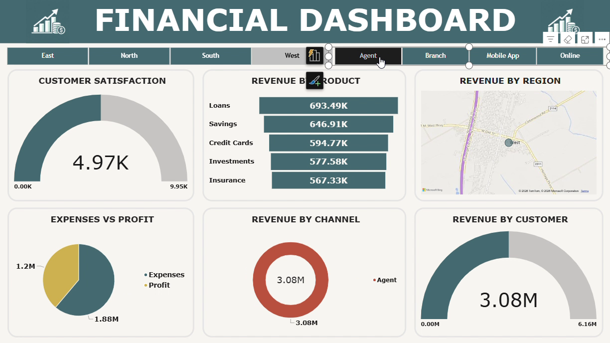

# Financial Analytics Dashboard | Power BI

## Project Overview

This project presents an interactive financial analytics dashboard developed in Microsoft Power BI. It explores revenue, expenses, profit, product performance, regional performance, sales channels, and customer satisfaction.

The analysis uses an Excel dataset containing 1,000 transaction records across 2024 and 2025.

## Dashboard Preview

### Dashboard overview



### Interactive filtering


## Objectives

- Monitor overall revenue, expenses, and profit.
- Compare revenue performance across financial products.
- Examine revenue distribution across regions and channels.
- Review customer satisfaction.
- Support exploration through interactive report filters.

## Tools Used

- Microsoft Power BI

## Dataset

The source workbook is provided in `data/financial_dashboard_dataset.xlsx`.

The dataset contains 1,000 transaction records and 10 columns, covering January 2024 through December 2025. Fields include transaction ID, date, region, product, channel, revenue, expenses, profit, customers, and customer satisfaction.

No additional data-cleaning or Power Query transformation steps were performed for this project. The original Excel dataset was used as supplied. The report's measures and visual calculations should be reviewed in Power BI before making further claims about the modelling process.

## Dashboard Features

- Revenue and customer satisfaction indicators
- Revenue by product
- Revenue by region
- Expenses versus profit
- Revenue by channel
- Interactive Region and Channel filters

## Selected Findings

Based on aggregation of the supplied Excel dataset:

| Metric | Result |
|---|---:|
| Total revenue | 51,661,414.49 |
| Total expenses | 33,602,203.43 |
| Total profit | 18,059,211.06 |
| Profit margin | 34.96% |
| Average customer satisfaction | 85.22 |

Additional observations:
- Insurance recorded the highest revenue among products: 11,928,150.85.
- North recorded the highest regional revenue: 13,685,026.78.
- Branch was the highest-revenue channel: 13,305,663.42.

These are descriptive results from the supplied dataset and do not establish causes of financial performance.

## Repository Structure

```text
Financial-Analytics-Dashboard/
├── README.md
├── data/
│   └── financial_dashboard_dataset.xlsx
├── dashboard/
│   └── financial_analysis.pbix
└── images/
    ├── dashboard_overview.png
    └── dashboard_interactive.png
```

## How to Explore

1. Download the `.pbix` file from `dashboard/`.
2. Open it using Power BI Desktop.
3. If Power BI requests the source workbook location, point it to `data/financial_dashboard_dataset.xlsx`.
4. Use the Region and Channel filters to explore the report.

## Notes

The dashboard file is provided for exploration. The Excel workbook is included as the source dataset. Ensure any future updates to the report are reflected in the documentation and screenshots.

## License

No license has been assigned to this repository.
